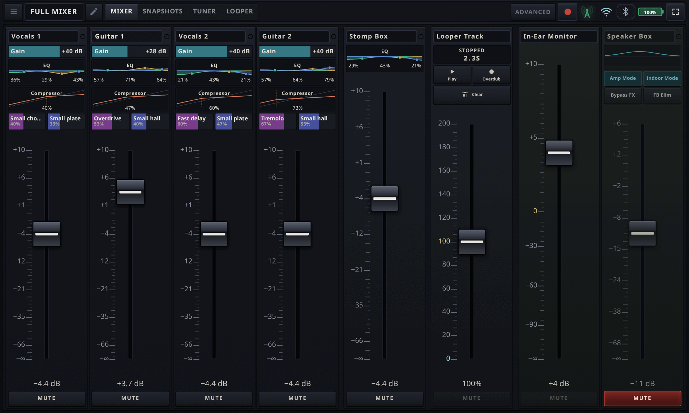
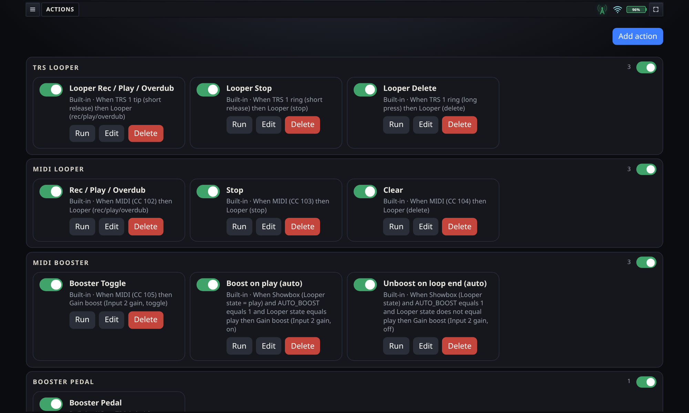
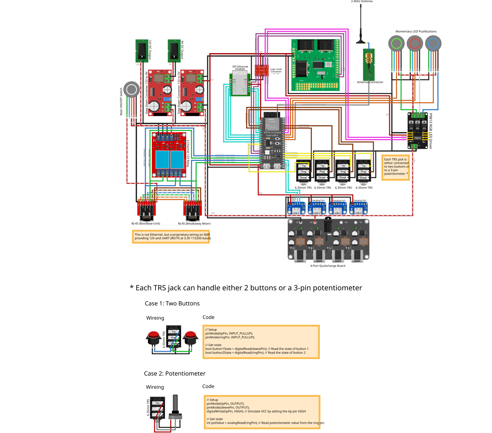
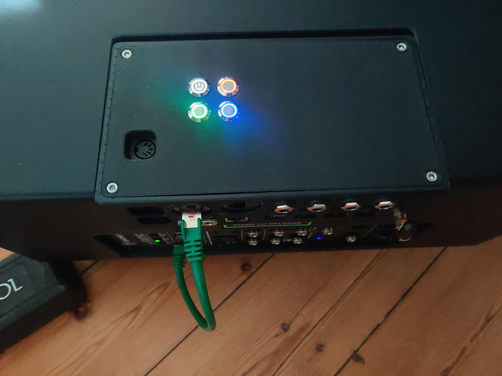
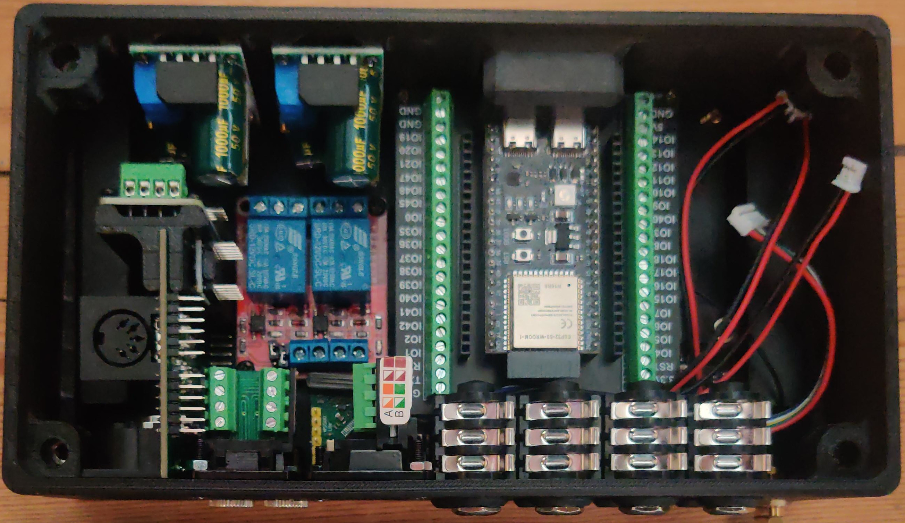
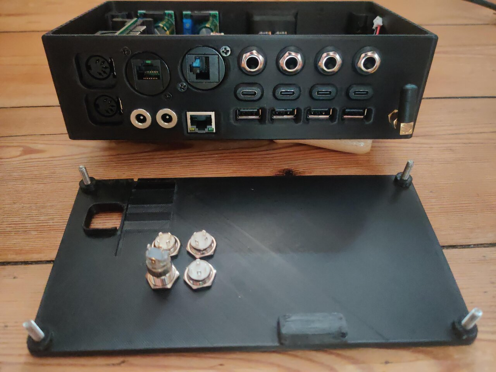
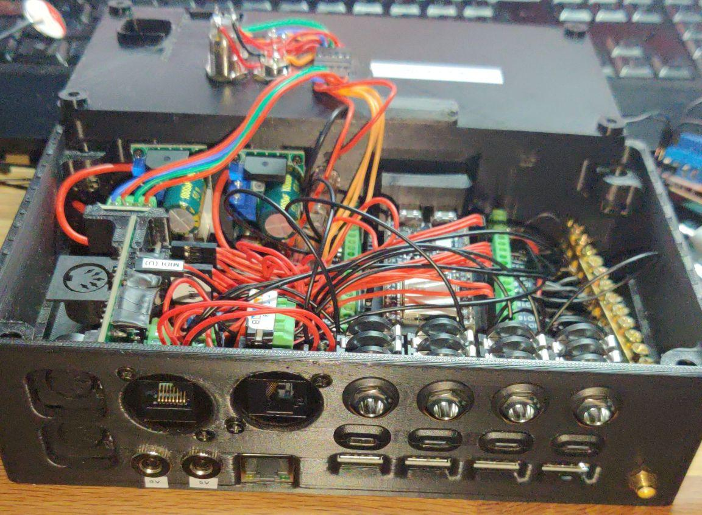

## Showbox Expansion Module

Gain more control over your Mackie Showbox. An ESP32-S3 sits between the Showbox base unit and the Breakaway Mixer, so you can drive presets, volume, EQ, effects, the looper, and more from footswitches, expression pedals, MIDI controllers, HID devices, or a browser on your phone or laptop.

### Features

- **Remote control** via tablet, phone, or laptop over Wi‑Fi or Ethernet, with as many devices in parallel as you want (`http://showbox.local`)
- **Full mixer control**: gains, faders, mute, EQ, compressors, FX sends/types, looper, snapshots, tuner, SD record, and more
- **Custom channel and snapshot names**
- **Full MIDI** via 5‑pin DIN, USB, Bluetooth, and Wi‑Fi/Ethernet (AppleMIDI / RTP‑MIDI)
- **USB/Bluetooth page turner**: use any pedal (TRS jack, MIDI, or wireless MIDI) to scroll on your tablet
- **Sophisticated web UI** with EQ graphs, compressor graphs, customizable views, etc.
- **Fully customizable actions** (any trigger, any action, any direction), for example:
  - Two-button looper
  - Boost pedal
  - FX change pedal
  - Snapshot load pedal
  - Sync a Behringer X‑Touch Compact with the Showbox
- **Footswitches and expression pedals**: up to 4 dual TRS jacks (tip + ring per jack)
- **DC jacks** to power your 9 V and 12 V pedals
- **USB ports** to power your USB devices
- **3D-printable case** ([GrabCAD model](https://grabcad.com/library/showboxexpansionmodule-v1-1))
- **Wiring diagrams** provided below
- **Front panel** with 3 customizable LED buttons
- **Updates** via browser [Web Installer](https://t-vk.github.io/ShowboxExpansionModule/) or OTA over the network

### Web interface

Open `http://showbox.local` for a live mixer, snapshots, tuner, looper, and system pages.



The **Actions** page is where you wire footswitches, MIDI, panel buttons, and Showbox state changes to whatever should happen next:



### Actions

Actions are *when → (optional if) → then* rules stored on the module and edited in the web UI.

**Triggers** can be:

- TRS footswitch gestures (press, long press, short/long release, double)
- Front-panel buttons
- MIDI (notes, CC, PC, and friends on any enabled port)
- Showbox entity / packet changes (e.g. looper state)
- Connection up/down events
- Variable changes

**Then** steps can:

- Change Showbox controls, run the looper, recall snapshots, toggle SD record, or open the tuner
- Apply a **gain boost** (manual or auto-with-looper)
- Send MIDI out any port
- Emit HID (keys, media keys, mouse, touch)
- Flip module radios / USB mode
- Set variables used by other rules

Groups of rules can be enabled or disabled together. Built-in groups ship ready for a TRS or MIDI looper pedal, a MIDI/TRS booster, and the front-panel buttons. Edit or replace them as you like.

### Getting started

Build a minimal ESP32 + two RJ45 breakouts, or the full reference design:

- [Parts List](./PartsList.md)
- [Schematics](https://raw.githubusercontent.com/T-vK/ShowboxExpansionModule/refs/heads/main/docs/schematics.svg)
- [Pin Mappings](#pin-mappings-for-esp32-s3)
- [3D Model](https://grabcad.com/library/showboxexpansionmodule-v1-1)
- [Firmware Web Installer](https://t-vk.github.io/ShowboxExpansionModule/)

Firmware can also be built and flashed with PlatformIO.

### Hardware

Everything is off-the-shelf (AliExpress, eBay, etc.): ESP32-S3, RJ45 breakouts, optional MIDI DIN, W5500 Ethernet, TRS jacks, and a 3D-printable case. The reference design wires all supported features; a minimal build only needs the ESP and the two Showbox links.

#### Schematics

[](https://raw.githubusercontent.com/T-vK/ShowboxExpansionModule/refs/heads/main/docs/schematics.svg)

#### Photos of the reference design

[](./docs/expansion-module-slid-in.jpeg) [](./docs/expansion-module-top-open.jpeg)  
[](./docs/expansion-module-front-open.jpeg) [](./docs/expansion-module-open-wired.jpeg)

## Pin Mappings for ESP32-S3

Note: If you are using an ESP32 instead of an ESP32-S3, adjust the pin mappings accordingly.

### SPI Ethernet Module (Mini W5500)

```
µC Pin | Module Pin
-------------------
 6     | nReset
 7     | MISO
15     | nINT
16     | nSS
17     | SCLK
18     | MOSI
```

### TRS Jacks (For Footswitches / Expression Pedals)

```
µC Pin | Module Pin
-------------------
 8     | TRS 1 Tip
 2     | TRS 1 Ring
21     | TRS 2 Tip
 1     | TRS 2 Ring
47     | TRS 3 Tip
 4     | TRS 3 Ring
48     | TRS 4 Tip
 5     | TRS 4 Ring
```

### MIDI UART Module (Arduino MIDI Shield)

```
µC Pin | Module Pin
-------------------
 9     | TX
10     | RX
```

### Front-panel LED buttons

White is a latching power button on the reference design (not an ESP GPIO).
Red / green / blue are momentary buttons; their LEDs are simple on/off indicators
(one P9813 drives the three channels — not per-button RGB rings).

```
µC Pin | Module Pin
-------------------
42     | P9813 Data In
41     | P9813 Clock In
40     | Green Button (Wi‑Fi)
39     | Red Button (USB)
38     | Blue Button (Bluetooth)
```

### Mackie Showbox Base-Unit

```
µC Pin | Module Pin
-------------------
11     | TX
12     | RX
```

### Mackie Showbox Breakaway Mixer

```
µC Pin | Module Pin
-------------------
13     | RX
14     | TX
```
